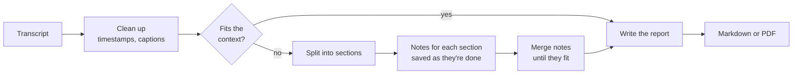

# transcript-report

Turn a YouTube video's transcript into an honest, practical briefing, using a local model
on your own GPU. Nothing leaves your machine.

You give it a transcript; it gives you a report with:

- a **TL;DR** and executive summary, and who the video is for
- the **actionable points**, prioritised by impact and effort, and a phased **implementation plan**
- an **accuracy check** of the main claims (✅ / ⚠️ / ❌ / ❓), and which ones to verify yourself
- **critical analysis**: bias and sponsorships, weak arguments, what's missing, speaker credibility
- a **glossary** and the **resources** mentioned
- a **content density score** (how much is filler) and an **AI-generated likelihood** score

See a full example: [examples/sample_report.md](examples/sample_report.md).

> **TL;DR:** A 24-minute SaaS growth video delivers five solid early-stage tips in roughly
> 5 minutes, buried under ~80% filler, sponsor reads, and recycled loops.

Reports are saved as Markdown or PDF. Videos of any length work: long ones are split into
sections, summarised, and combined.

## Requirements

- **[LM Studio](https://lmstudio.ai) or [Ollama](https://ollama.com)** (both free), which
  runs the model. The steps below are for LM Studio; for Ollama, see
  [Using Ollama](#using-ollama).
- **A GPU with roughly 8 GB of VRAM or more.** NVIDIA is what it's tested on; anything LM
  Studio or Ollama supports should work.
- **Python 3.10 or newer.** It has no dependencies: only the standard library is used.
- **Microsoft Edge or Google Chrome**, only for PDF reports. Edge comes with Windows.

It's developed and used on Windows 11. The code also supports macOS and Linux (LM Studio
runs there too), but those haven't been tried on real videos yet. Reports of how it goes
are welcome.

## Quick start

1. **Install LM Studio** and open it once, so its `lms` command-line tool is set up.
2. **Download a model** in LM Studio (see [Choosing a model](#choosing-a-model)), then run
   `lms ls` to see its key.
3. **Install transcript-report** (needs [Git](https://git-scm.com); or download the ZIP from
   GitHub and run `python -m pip install <unzipped folder>`):
   ```
   python -m pip install git+https://github.com/<owner>/transcript-report
   ```
4. **Create your settings and folders:**
   ```
   python -m transcript_report --init
   ```
   This creates a `transcript-report` folder in your home folder (for example
   `C:\Users\you\transcript-report`) with `settings.json`, a `transcripts` folder and a
   `reports` folder. In `settings.json`, replace `REPLACE-with-a-key-from-lms-ls` with your
   model's key, and set `"ctx"` (see the table below).
5. **Check the setup:**
   ```
   python -m transcript_report --check
   ```
   It tests the settings, LM Studio (or Ollama), the model and the PDF browser, and says what
   to fix.
6. **Add a transcript and run it.** Paste a transcript into a `.txt` file in the
   `transcripts` folder (see [Getting a transcript](docs/usage.md#getting-a-transcript)),
   then:
   ```
   python -m transcript_report "My video.txt" --title "Video title - Channel"
   ```
   The report is saved in `reports/My video/`, and the transcript moves to
   `transcripts/done/`.

> **The `transcript-report` command.** pip also installs a `transcript-report` command, so
> you can type `transcript-report "My video.txt"` instead. On Windows with **Smart App
> Control** turned on, that command is blocked, because the small `.exe` pip makes for it
> isn't signed. `python -m transcript_report` does exactly the same thing and always works.

**Running from a clone instead.** `git clone` the repository and use
`python analyse_video.py ...` in that folder, with no install. Settings and the transcripts
and reports folders are then kept in the project folder itself (`--init` creates them there).

**Using another folder.** To keep settings, transcripts and reports somewhere else, set the
`TRANSCRIPT_REPORT_HOME` environment variable to that folder.

**LM Studio on another computer.** Turn on *Serve on Local Network* in LM Studio's server
settings on that computer, then set `"server_url"` in `settings.json` (for example
`"http://192.168.1.20:1234"`) or pass `--server-url`. The server there isn't started or
stopped for you, but the model is still loaded and unloaded. If that server requires an API token,
set `"api_token"` too.

## Using Ollama

[Ollama](https://ollama.com) can run the model instead of LM Studio.

1. **Install Ollama**, then **download a model**, for example `ollama pull qwen3:14b`.
   `ollama list` shows the names of the models you have. A name without a tag, such as
   `qwen3`, means `qwen3:latest`.
2. **In `settings.json`** (created with `--init`, as in the [Quick start](#quick-start)),
   fill in the `my-ollama-model` entry, or add an entry like this one inside `"models"`, with
   your model's Ollama name as the key. Then set `"default_model"` to its name
   (`"qwen3-14b"` here):
   ```json
   "qwen3-14b": {"key": "qwen3:14b", "runner": "ollama", "ctx": 32768}
   ```
   To use Ollama for every model that doesn't set its own `"runner"`, set
   `"runner": "ollama"` at the top level instead. `--runner ollama` does the same for one run.
3. **Run `--check`.** It finds the `ollama` command, the server and its version, and your
   model.

If Ollama isn't running, the script starts `ollama serve` for the run and stops it
afterwards. If it's already running (for example the Ollama app), it's used and left
running. The model is loaded at the start and unloaded at the end, as with LM Studio; if the
script is stopped before it can unload it, Ollama unloads it by itself within 30 minutes. If
Ollama already had the model loaded, that copy is used and stays loaded until it would have
expired anyway.

**The context is always set.** Ollama otherwise picks a context size from your VRAM (4k
below 24 GB), which is far too small for a transcript, and a different size means reloading
the model. So the `"ctx"` from `settings.json` (or `--ctx`) is sent with every request. If
it's bigger than the model supports, Ollama caps it and the script warns and uses the smaller
size. A transcript that doesn't fit fails with "too long" instead of being cut: Ollama's
own default is to cut or shift an input that doesn't fit, and that's turned off.

**Settings that only Ollama's server takes**, as environment variables set where Ollama
runs, before it starts. When the script starts `ollama serve` itself, it passes its own
environment on, so setting them in the same terminal works:

- `OLLAMA_FLASH_ATTENTION=1` turns on flash attention.
- `OLLAMA_KV_CACHE_TYPE` sets how the context is stored: `f16`, `q8_0` or `q4_0`. The
  smaller types use less memory. It needs flash attention on.
- `OLLAMA_NUM_PARALLEL` sets how many requests Ollama serves at once. Each one gets the full
  context, so the context's memory use multiplies by it. The script only sends one at a time,
  so leave it at 1 if VRAM is tight.

If the script warns that part of the model is on the CPU, it didn't all fit in VRAM and will
be slow: lower `ctx`, or try the settings above.

**Thinking.** Without `--think`, models that can think are told not to. With `--think`, a
model that can't think stops with a clear error.

**Ollama on another computer.** Start Ollama there with `OLLAMA_HOST=0.0.0.0` set, so it
accepts connections from other computers, then set `"server_url"` here (for example
`"http://192.168.1.20:11434"`) or pass `--server-url`. Ollama's API has no authentication,
so anyone on the network can use it; only do this on a network you trust. `"api_token"` is
only needed for a proxy in front of Ollama that asks for one.

**Using both LM Studio and Ollama.** `"server_url"` and `"api_token"` are for the runner
named by `"runner"`. Models on the other runner use it on this computer, with no token (for
one run, `--server-url` can point them elsewhere). For example, LM Studio on another
computer and Ollama here:
```json
"runner": "lmstudio",
"server_url": "http://192.168.1.20:1234",
"models": {
  "lm-model": {"key": "qwen/qwen3-14b"},
  "ollama-model": {"key": "qwen3:14b", "runner": "ollama"}
}
```
So LM Studio's address and token never go to Ollama, or the other way round. Both runners
on other computers at once isn't supported yet.

## Everyday use

```
python -m transcript_report "My video.txt"          analyse one transcript
python -m transcript_report "My video.txt" --pdf    ... and save the report as a PDF
python -m transcript_report --all                   analyse everything waiting in the folder
python -m transcript_report "Long video.txt" --resume   continue a long run that stopped
```

Transcripts can be text copied from YouTube's **Show transcript** panel, or `.srt` / `.vtt`
subtitle files (for example YouTube's auto-generated captions, downloaded with yt-dlp).

All the options, settings, custom prompts and troubleshooting are in
**[docs/usage.md](docs/usage.md)**.

## Choosing a model

Pick an instruction-tuned model of 7–14B parameters in GGUF format, at a quantisation that
leaves room in VRAM for the context. Longer contexts mean fewer, bigger sections for long
videos, which gives better reports. Rough starting points:

| VRAM | Model size and quantisation | `ctx` to try |
|---|---|---|
| 8 GB | 7–9B at Q4_K_M | 16384 |
| 12 GB | 8–9B at Q6_K (tested: Qwen3.5 9B Q6_K uses about 9.1 GB at 65536) | 32768–65536 |
| 16 GB | 12–14B at Q4_K_M–Q5_K_M | 32768 |
| 24 GB | 14B at Q8_0, or 24–32B at Q4_K_M | 32768–65536 |

These are estimates, apart from the tested row: memory use depends on the model's
architecture. After the model loads, the script prints the VRAM in use and warns if less than
2 GB is free. If it does, lower `ctx`, because once VRAM runs out the GPU falls back to much
slower shared memory.

With Ollama, the tag picks the size and quantisation (for example `qwen3:14b`); the
model's page on ollama.com lists them.

The default sampling settings suit Qwen-style models. For other models, set the values from
the model's card under `"sampling"` in `settings.json`. They're sent the same way to
LM Studio and Ollama.

## How it works



- The script starts LM Studio's or Ollama's server if needed, loads the model (in LM Studio
  with one request slot and flash attention), and unloads it at the end so your VRAM is free
  again. If you already had the model loaded, it uses that copy and leaves it loaded.
- Token counts are estimated on the high side, without a tokenizer.
- PDFs are made by printing the report with Edge or Chrome in headless mode, so no PDF
  library is needed.

## Limitations

- **The accuracy check is offline.** The model only knows what it learnt in training, so
  recent or very specific claims are marked ❓ Can't verify, and the report lists claims to
  check yourself. Treat its verdicts as a starting point, not a fact-check.
- **The report is only as good as the model and the transcript.** Small models miss nuance,
  and auto-generated captions have no punctuation and contain misheard words (the report
  notes these under Confidence Notes).
- The prompts are written for English-language tech and business videos.

## Privacy

Everything runs locally: the transcript, the model and the report stay on your machine. The
script only talks to LM Studio or Ollama, on `127.0.0.1` unless you set `server_url` to
another computer. In that case the transcript is sent there over plain HTTP, so only do that on a
network you trust.

## Development

```
python -m unittest discover -s tests -t .
```

The tests need no GPU, LM Studio or Ollama: the model is replaced by a fake. They run on GitHub
Actions on Windows, macOS and Linux with Python 3.10–3.14.

Lint with `ruff check .` (settings in `pyproject.toml`). See
[CONTRIBUTING.md](CONTRIBUTING.md) for more.

The code is in `transcript_report/`, one job per module; the docstring in
`transcript_report/__init__.py` has a map. `python -m pip install -e .` installs it from your
clone so that changes take effect straight away (settings stay in the project folder).

## License

[MIT](LICENSE)
